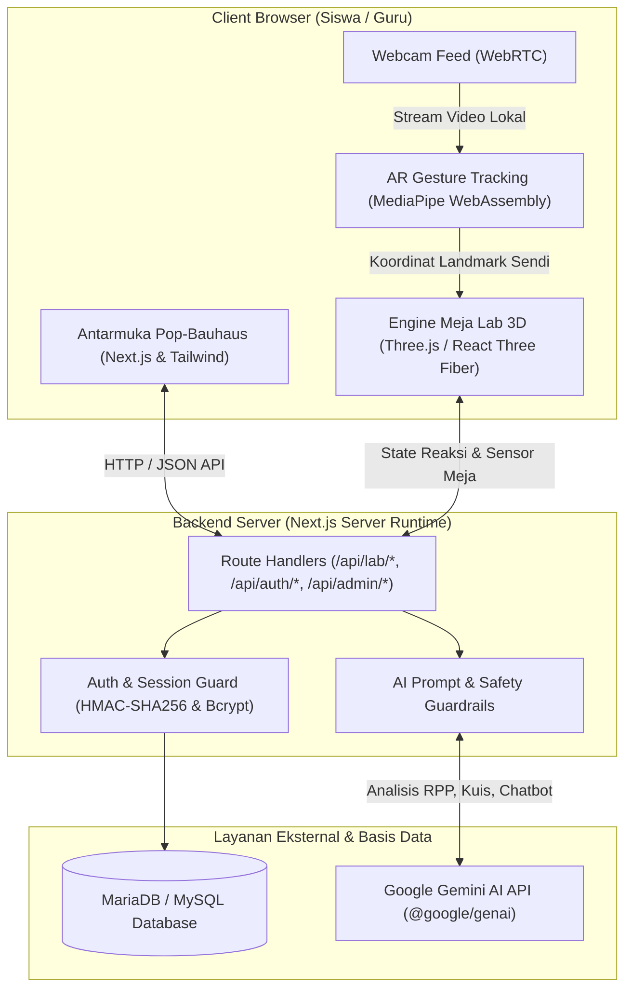
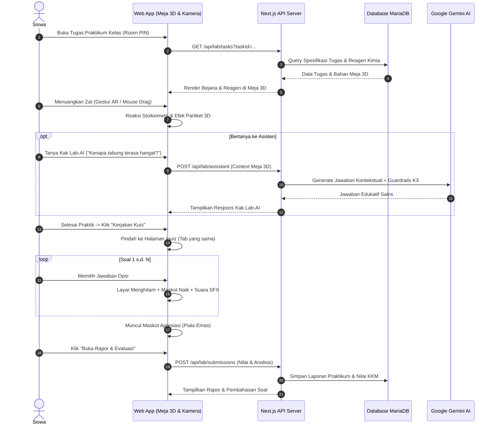

# 🧪 CAPCIPCUP SMARTEDU — 3D Virtual Science & Chemistry Laboratory
> **Platform Laboratorium Sains & Praktikum Reaksi Kimia Virtual Berbasis 3D WebGL, AR Hand Gesture Tracking, dan Asisten Evaluasi AI.**

---

## 👥 Informasi Tim Pengembang
- **Nama Tim:** Capcipcup Developer Team
- **Kategori Lomba / Karya:** Aplikasi Web (**Web Application**)
- **Nama Aplikasi:** **Capcipcup SmartEdu** (CupLabs)

### Daftar Anggota Tim:
| No. & Peran | Nama Lengkap | Nomor Induk Mahasiswa (NIM) |
| :---: | :--- | :---: |
| **Anggota 1** | **Farel Fadlillah** | **110012600046** |
| **Anggota 2** | **Muhammad Assegaf Al Khalifi** | **110012600138** |
| **Anggota 3** | **Mishya Yumna Ramadhani** | **110012600303** |
| **Anggota 4** | **Ghina Syakirah** | **110012600278** |

---

## 💡 Deskripsi Solusi, Masalah Nyata, & Target Pengguna

### 1. Masalah Nyata yang Diangkat (*Problem Statement*)
1. **Keterbatasan Fasilitas & Sarana:** Banyak sekolah (terutama di daerah 3T dan sekolah berkembang) belum memiliki laboratorium kimia lengkap, bejana kaca borosilikat, maupun pasokan reagen kimia rutin karena kendala anggaran operasional.
2. **Faktor Risiko & Keselamatan (K3):** Praktikum kimia nyata melibatkan zat berbahaya (asam/basa kuat, uap korosif, reaksi eksotermik pelepasan kalor, risiko kebakaran). Siswa pemula sering kali merasa takut atau ragu untuk mencoba reaksi karena risiko cedera.
3. **Ketiadaan Evaluasi & Umpan Balik Cepat:** Pada metode konvensional, laporan praktikum dikumpulkan berhari-hari setelah eksperimen selesai, sehingga pemahaman konsep sains yang keliru tidak langsung terdeteksi atau terkoreksi.
4. **Beban Administratif Guru:** Guru membutuhkan waktu yang cukup lama untuk menyusun modul instruksi kerja laboratorium dan butir soal kuis evaluasi yang selaras dengan Capaian Pembelajaran Kurikulum Merdeka.

### 2. Solusi yang Ditawarkan (*Solution Overview*)
**Capcipcup SmartEdu** menghadirkan laboratorium virtual imersif yang dapat diakses langsung melalui peramban web modern tanpa memerlukan perangkat keras khusus:
- **Meja Sains 3D Interaktif:** Siswa dapat memegang, menuangkan zat (*tilt & pour*), dan mengamati reaksi stoikiometri secara real-time dengan visual fluida dinamis, meniskus cairan, perubahan suhu bejana, buih gas, dan kristal presipitasi.
- **Kontrol Gestur Tangan AR Bebas-Sentuh:** Memanfaatkan kamera webcam biasa untuk mendeteksi koordinat telapak tangan siswa secara spasial (*pinch to lift, tilt to pour*), menghadirkan sensasi bereksperimen nyata tanpa menyentuh keyboard/mouse.
- **Kak Lab-AI (Asisten Interaktif Cerdas):** Membimbing siswa secara real-time dengan kesadaran situasional meja lab (*situational awareness*) dan guardrail pedagogis ketat (fokus sains dan keselamatan K3).
- **Portal Guru & Generator Kuis AI Otomatis:** Guru cukup mengetik atau menempelkan teks RPP / Modul Ajar, AI akan secara otomatis menganalisis materi, memilihkan bahan kimia di meja 3D, menyusun panduan kerja, dan memproduksi butir soal kuis evaluasi.
- **Arena Kuis Mandiri Berbasis Apresiasi:** Alur pengerjaan kuis satu per satu dengan animasi layar sinematik, umpan balik maskot edukatif, dan rapor diagnostik ilmiah instan.

### 3. Target Pengguna (*Target Audience*)
- **Siswa Sekolah Menengah (SMP & SMA) & Siswa SD:** Sebagai media eksperimen sains yang aman, menyenangkan, dan interaktif.
- **Guru Mata Pelajaran IPA / Kimia:** Sebagai platform perancangan tugas praktikum, pembagian kelas berbasis Room PIN, dan pemantau nilai otomatis.
- **Sekolah & Institusi Pendidikan:** Sebagai solusi laboratorium virtual hemat biaya, ramah lingkungan, dan minim risiko keselamatan kerja.

---

## 🌟 Fitur Utama Aplikasi

### 1. 🔬 Meja Laboratorium 3D Dual-Graphics
- **Mode Low (Hemat Daya & Ringan):** Dioptimalkan untuk perangkat mobile dan laptop spesifikasi standar dengan performa stabil 60 FPS.
- **Mode HD Realistis (True Borosilicate Glass 3.3):** Menggunakan PBR Physical Material dengan refraksi optik kaca (*transmission* = 0.92, *ior* = 1.52), pembiasan meniskus fluida (*ior* = 1.33), pantulan meja epoksi glossy, serta partikel volumetrik reaksi (buih *effervescence* CO2, uap panas termal, endapan *Golden Rain* $\text{PbI}_2$).
- **Katalog Zat Lengkap:** Puluhan reagen asam, basa, garam, indikator pH (Fenolftalein, Bromtimol Biru), dan oksidator kuat dengan informasi fasa, warna, dan catatan keselamatan K3.

### 2. 🖐️ Kontrol Spasial AR Hand Gesture Tracking
- Menggunakan model WebAssembly **Google MediaPipe HandLandmarker** yang berjalan 100% di browser pengguna secara lokal (tanpa mengirim video webcam ke server, privasi terjaga).
- Mendeteksi 21 titik sendi tangan:
  - *Hover / Pointing:* Membidik bejana kimia.
  - *Pinch / Grab:* Menjepit dan mengangkat bejana.
  - *Tilt & Pour:* Memiringkan bejana untuk menuang isi cairan ke bejana lain.
  - *Mouse & Touch Fallback:* Navigasi drag-and-drop mulus bagi perangkat tanpa webcam.

### 3. 🤖 Kak Lab-AI — Asisten Laboratorium Cerdas
- Terhubung langsung dengan **Google Gemini AI SDK**.
- Memiliki **Kesadaran Situasional Meja Lab (Real-Time Situational Awareness)**: Kak Lab-AI mengetahui bejana apa yang ada di meja siswa, zat yang sedang dituangkan, perubahan suhu, dan reaksi yang baru saja terjadi.
- **Guardrails Ketat:** Dilengkapi filter anti-prompt injection, penolakan permintaan di luar sains (misal kode pemrograman atau teks berbahaya), serta edukasi keselamatan kerja K3.

### 4. 👨‍🏫 Portal Guru & Pembuat Tugas Cerdas (RPP AI)
- **Mode Analisis RPP Otomatis:** Guru mengunggah atau menempelkan teks RPP, AI akan mengekstrak judul, jenjang (SD/SMP/SMA), reagen kimia meja 3D, dan 3 butir soal observasi kuis secara otomatis.
- **Mode Kustom Mandiri:** Guru bebas memilih reagen dari katalog, menentukan target reaksi kimia, menuliskan instruksi kerja, dan menyusun kuis manual.
- **Pengaturan Kelulusan (KKM):** Guru dapat menentukan batas KKM (0–100), opsi pengulangan kuis (*remedial*), dan keterbukaan pembahasan soal.

### 5. 🏆 Arena Kuis Interaktif & Rapor Evaluasi Halaman Penuh (`/quiz`)
- Dijalankan di halaman mandiri pada tab yang sama (bukan modal popup).
- Soal muncul **satu per satu** dengan progress bar dan efek audio synthesizer (Web Audio API).
- Animasi layar sinematik menghitam dengan kemunculan maskot edukasi (*Prof. Cupcup*):
  - **Jawaban Benar:** Maskot Senang dengan chime nada tinggi.
  - **Jawaban Salah:** Maskot Menyemangati dengan kunci jawaban benar dan pembahasan ilmiah.
  - **Selesai Kuis:** Maskot Apresiasi Piala Emas sebelum membuka lembar evaluasi lengkap.

### 6. 🏫 Manajemen Ruang Kelas Terisolasi (Smart Classroom)
- Sistem PIN Kelas (contoh: `KIM10A`, `KIM11B`) untuk memisahkan data siswa, tugas praktikum, rekap nilai kuis, dan log konsultasi AI per ruang kelas.

---

## 🛠️ Tech Stack Lengkap

| Lapisan Sistem | Teknologi / Library | Keterangan & Kegunaan |
| :--- | :--- | :--- |
| **Frontend Framework** | **Next.js 16 (Turbopack)** | Framework React modern dengan App Router, Server Components, dan arsitektur modular. |
| **Bahasa Pemrograman** | **TypeScript 5** | Menjamin keamanan tipe data (*type safety*) dan keandalan kode skala besar. |
| **Simulasi & Visual 3D** | **Three.js**, **@react-three/fiber**, **@react-three/drei** | Rendering grafis meja lab, bejana kaca borosilikat, fasa fluida, meniskus, dan sistem partikel reaksi. |
| **Computer Vision & AR** | **@mediapipe/tasks-vision** | Pelacakan gestur tangan 21-landmark berbasis WebAssembly & WebRTC tanpa server tambahan. |
| **Desain Antarmuka & Tema** | **Tailwind CSS 4**, **Lucide React** | Desain Pop-Bauhaus Neo-Brutalist yang ramah anak, bersih, dan berkarakter edukatif. |
| **Backend & Routing** | **Next.js Route Handlers (API)** | RESTful API serverless untuk auth, manajemen kelas, tugas lab, dan interaksi AI. |
| **Basis Data** | **MariaDB / MySQL 8.0** via `mysql2/promise` | Penyimpanan persisten untuk pengguna, kelas, tugas, riwayat pengumpulan, dan log AI. |
| **Keamanan & Sesi** | **HMAC-SHA256 Cookie Signing** & **Bcryptjs** | Autentikasi sesi aman, pencegahan *privilege escalation*, dan hashing password 10 salt rounds. |
| **Kecerdasan Buatan (AI)** | **Google Gemini 2.5 / 2.0 Flash** via `@google/genai` | Engine Kak Lab-AI, analisis pedagogis RPP, generator kuis otomatis, dan simulasi reaksi kimia dinamis. |

---

## 📐 Arsitektur Sistem & Alur Data

### 1. Diagram Arsitektur Komponen Sistem


### 2. Diagram Alur Praktikum & Evaluasi Siswa


---

## 💻 Panduan Instalasi & Menjalankan Aplikasi Secara Lokal

### 1. Prasyarat Sistem
- **Node.js:** Versi `18.x`, `20.x`, atau yang lebih baru.
- **Package Manager:** `npm` (bawaan Node.js).
- **Web Server & Database:** XAMPP, Laragon, atau MariaDB/MySQL standalone aktif di port `3306`.
- **Koneksi Internet:** Diperlukan untuk panggilan SDK Gemini AI.

---

### 2. Langkah Instalasi

#### A. Clone Repository & Masuk ke Folder Proyek:
```bash
git clone https://github.com/Monsterdeveloper01/capcipcup.git
cd capcipcup
```

#### B. Install Seluruh Dependensi:
```bash
npm install
```

#### C. Konfigurasi Variabel Lingkungan (`.env.local`):
Salin file template [`.env.example`](file:///.env.example) menjadi `.env.local`:
```bash
cp .env.example .env.local
```
Sesuaikan isi file `.env.local` dengan konfigurasi lokal Anda:
```env
# Konfigurasi Database MySQL/MariaDB Lokal
DB_HOST=127.0.0.1
DB_PORT=3306
DB_NAME=capcipcup-db
DB_USER=root
DB_PASSWORD=

# Google Gemini AI API Key (Dapatkan gratis di https://aistudio.google.com/app/apikey)
GEMINI_API_KEY=masukkan_api_key_gemini_anda_di_sini

# Kunci Enkripsi Sesi (Opsional, sudah ada fallback default aman)
SESSION_SECRET=capcipcup_super_secret_session_salt_2026
```

#### D. Migrasi & Seed Database Otomatis:
Jalankan skrip inisialisasi database untuk membuat struktur tabel dan mengisi data awal (katalog kimia, ruang kelas, 2 guru, dan 29 akun murid):
```bash
# 1. Buat tabel, relasi, katalog zat, dan ruang kelas awal
node scripts/setup_local_db.js

# 2. Seed 2 guru dan 29 murid terdistribusi ke kelas KIM10A & KIM11B
node scripts/seed_29_students_2_teachers.js
```

#### E. Jalankan Server Pengembangan:
```bash
npm run dev
```
Buka browser dan akses aplikasi di: **`http://localhost:3000`**

---

## 🔑 Kredensial Akun Demonstrasi Pengujian

Untuk mempermudah dewan juri / penguji mengevaluasi seluruh fitur sistem (Portal Siswa, Portal Guru, dan Portal Admin), telah disediakan akun demonstrasi teruji berikut:

| Peran Akun | Username | Password | Keterangan & Hak Akses |
| :--- | :--- | :--- | :--- |
| **Guru Kimia 1** | `guru.rina` | `GuruRina2026!` | Pengampu Kelas **X IPA 1** (Kode PIN: `KIM10A`). Memiliki akses buat tugas RPP AI, kelola kelas, dan rekap nilai 10 murid. |
| **Guru Kimia 2** | `guru.hendra` | `GuruHendra2026!` | Pengampu Kelas **XI IPA 2** (Kode PIN: `KIM11B`). Akses penuh penugasan praktikum reaksi dan pantau analitik siswa. |
| **Murid Kelas 10** | `murid01` | `Siswa01#2026` | Siswa aktif di kelas `KIM10A` (Bisa langsung membuka tugas lab atau eksplorasi bebas meja 3D). |
| **Murid Kelas 11** | `murid11` | `Siswa11#2026` | Siswa aktif di kelas `KIM11B` (Praktikum termokimia & reaksi larutan). |
| **Murid Baru (Belum Kelas)** | `murid21` | `Siswa21#2026` | Siswa yang dapat menguji fitur **"Gabung Kelas dengan PIN"** (`KIM10A` atau `KIM11B`). |
| **Administrator** | `admin` | `admin123` | Akses manajemen sistem, statistik pengguna, dan monitoring server. |

> *(Daftar lengkap seluruh 29 murid tertera di dokumen [`docs/AKUN_GURU_DAN_MURID.md`](docs/AKUN_GURU_DAN_MURID.md)).*

---

## 🤖 Dokumentasi Penggunaan AI & Atribusi Pihak Ketiga

### 1. Dokumentasi Integrasi Kecerdasan Buatan (AI)
Aplikasi ini memanfaatkan kecerdasan buatan terapan pada 4 titik strategis:

| Modul Fitur AI | Model AI yang Digunakan | Cara Kerja & Manfaat Pedagogis |
| :--- | :--- | :--- |
| **Kak Lab-AI (Workbench Assistant)** | `gemini-2.5-flash`<br>*(Fallback: `gemini-2.0-flash` / `gemini-1.5-flash`)* | Memberikan bimbingan sains real-time berbasis sensor meja 3D. Menjelaskan mengapa terjadi pelepasan kalor (eksoterm), reaksi pembentukan gas, dan tips keselamatan kerja laboratorium K3. |
| **AI RPP & Modul Ajar Analyzer** | `gemini-2.5-flash` | Menguraikan teks silabus / RPP Kurikulum Merdeka yang diinput guru, lalu mengekstrak judul tugas, jenjang kompetensi, memilih reagen kimia yang relevan di meja 3D, serta merumuskan kuis. |
| **Generator Kuis Sains AI** | `gemini-2.5-flash` | Menghasilkan soal pilihan ganda berbasis observasi praktikum lengkap dengan 4 opsi, kunci jawaban terkalibrasi, serta penjelasan ilmiah (*scientific reasoning*). |
| **Simulasi Reaksi Bebas Dinamis** | `gemini-2.5-flash` | Menghitung produk reaksi stoikiometri, persamaan reaksi seimbang, perubahan warna cairan, dan variasi suhu untuk zat yang dicampur di luar katalog statis. |
| **Computer Vision (AR Hand Tracking)** | `Google MediaPipe HandLandmarker` | Mendeteksi 21 titik koordinat anatomi tangan secara lokal (*on-device client-side*) untuk interaksi fisik mengangkat dan menuangkan tabung reaksi tanpa latensi server. |

### 2. Atribusi Aset & Pustaka Pihak Ketiga (*Third-Party Assets*)
- **Pustaka Grafis & Animasi 3D:** Three.js (Ricardo Cabello / Mr.doob dkk., Lisensi MIT) & React Three Fiber (Pmndrs, Lisensi MIT).
- **Model Pembelajaran Mesin Visi Komputer:** Google MediaPipe HandLandmarker v0.10.x (`hand_landmarker.task` via Google LLC, Lisensi Apache 2.0).
- **SDK AI Generatif:** Google Gen AI SDK (`@google/genai` oleh Google LLC, Lisensi Apache 2.0).
- **Ikonografi Antarmuka:** Lucide Icons (Lucide Project Contributors, Lisensi ISC).
- **Tipografi:** Plus Jakarta Sans (Gumpita Rahayu / Tokotype), Space Grotesk (Florian Karsten), dan JetBrains Mono (JetBrains).
- **Karakter Maskot Edukasi:** Prof. Cupcup (Dibuat dan dirancang secara orisinal untuk Capcipcup SmartEdu).
- **Dataset Reaksi Kimia:** Disusun berdasarkan silabus resmi Kimia & IPA Kurikulum Merdeka Kemendikbudristek RI.

---

## 📄 Lisensi
Proyek **Capcipcup SmartEdu** dikembangkan untuk kepentingan kompetisi teknologi dan kemajuan pendidikan sains Indonesia di bawah lisensi terbuka **MIT License**.
